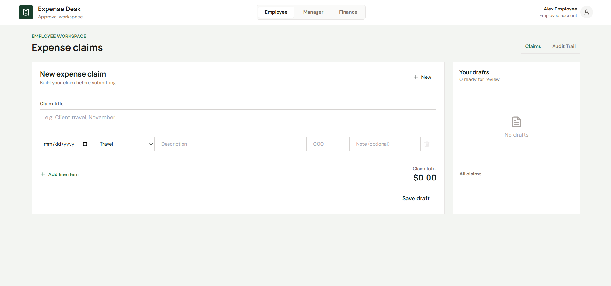
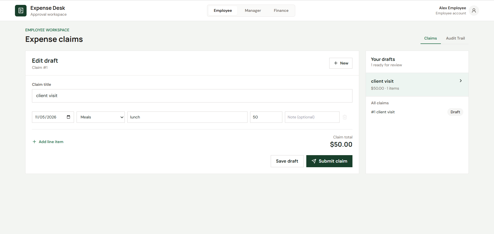
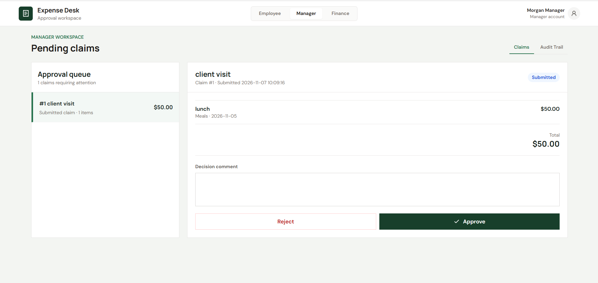
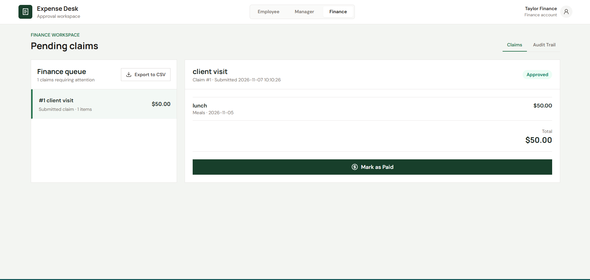

# Expense Approval System

A full-stack expense claim and approval workspace built with React, Tailwind CSS, Express, Node.js, and SQLite.

## Architecture Overview

```text
Browser / React UI
       |
       | JSON over HTTP
       v
Express API (localhost:3000)
       |
       | Better SQLite calls
       v
claimService + SQLite database
```

- `frontend/src` contains the role switcher, employee claim editor, approval queues, payment controls, and audit timeline.
- `src` contains Express routes, business rules, SQLite schema initialization, user seeding, and server startup.
- `test` contains backend business-rule tests using an isolated SQLite database.
- `data/expense.db` stores application data; a SQLite database is created automatically when the backend starts.

## Setup in 5 Steps

1. Open a terminal in the project root and install the backend dependencies:
   ```powershell
   npm install
   ```
2. Seed demonstration users:
   ```powershell
   npm run seed
   ```
3. Start the API at `http://localhost:3000`:
   ```powershell
   npm start
   ```
4. In a second terminal, install and start the frontend:
   ```powershell
   cd frontend
   npm install
   npm run dev
   ```
5. Open `http://localhost:5173`. Switch roles with the header control to exercise Employee, Manager, and Finance workflows.

Node.js 18 or newer and npm are required. For optional API configuration, copy `.env.example` to `.env` and export the variables in PowerShell before starting the backend.

## API

- `GET /api/health`
- `GET /api/users`
- `POST /api/users`
- `GET /api/claims`
- `GET /api/claims/export/csv`
- `GET /api/claims/:id`
- `POST /api/claims`
- `PUT /api/claims/:id`
- `POST /api/claims/:id/submit`
- `POST /api/claims/:id/decision`
- `POST /api/claims/:id/pay`

Create a claim:

```json
{
  "submittedBy": 1,
  "title": "Client trip",
  "currency": "USD",
  "lineItems": [
    {
      "expenseDate": "2026-11-07",
      "category": "Travel",
      "description": "Train ticket",
      "amount": 1200,
      "currency": "USD"
    }
  ]
}
```

Submit a claim: `{ "userId": 1 }`

Approve, reject, or pay: `{ "userId": 2, "decision": "Approved", "comment": "Reviewed" }` (the `decision` field is not used by the pay endpoint).

## Business Rules

1. Valid categories are `Travel`, `Meals`, `Office Supplies`, `Software`, and `Other`.
2. A `Meals` line item over 50 must include a non-empty note.
3. Claims totaling over 1000 require Manager approval followed by Finance approval. Claims at or below 1000 require Manager approval only.
4. A claimant cannot approve or reject their own claim.
5. Every created, submitted, approved, rejected, and paid status transition is recorded in `audit_trails`.

The database and tables are created automatically on first startup.

## Frontend

From a second terminal:

```powershell
cd d:\expense-approval-system\frontend
npm install
npm run dev
```

Open `http://localhost:5173`. The frontend source is in `frontend/src` and connects to the API at `http://localhost:3000`.

## Tests

```powershell
npm test
```
## Application Screenshots

### New Expense Claim Form


### Editing Draft Claim


### Manager Approval Queue


### Finance Approval Queue


### Claim Audit Trail
